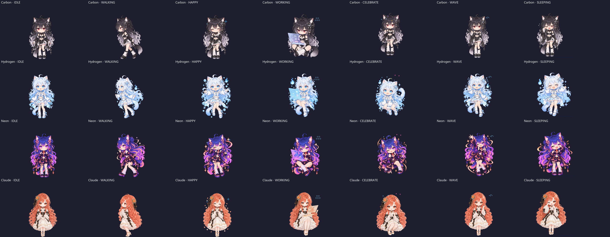

# AGY Pet · Antigravity Desktop Pet

**English** | [简体中文](README.md) | [日本語](README.ja.md)

A companion desktop pet and native Antigravity plugin that hangs out on your screen while you code with Antigravity. Built on the behavioral framework inspired by [QCYTSN/ds-local-pet](https://github.com/QCYTSN/ds-local-pet) (MIT)—preserving desktop strolling, zoned interactions, throw physics, window perching, local awareness, and crash recovery—it adds **five model-themed character forms** (**Carbon, Hydrogen, Neon, Argon, Claude**), **multi-companion subagent clones & desktop scenes**, a built-in **Token Meter**, a live **HUD bar**, an Antigravity sidebar control panel (**`agy-pet`**), and full **Chinese / English / Japanese** localization.



### Highlights

- **Five Model-Themed Forms**: Carbon, Hydrogen, Neon, Argon, and Claude—each with its own sprite frames, animation personality, favorite/disliked foods, and trilingual voice lines. Turn on **Follow Model** to switch forms automatically as Antigravity changes models.
- **Full Trilingual Localization (中文 / English / 日本語)**: Defaults to `auto` (detects OS/browser locale) with instant live hot-reload switching from the Antigravity sidebar, pet control panel, or system tray—covering UI, HUD, Token Meter, tooltips, tray menu, clone banter, AI live comments, and all 5 forms + 12 shared dialogue packs.
- **Native Antigravity Plugin Architecture**: The repository root is a standard Antigravity plugin (`plugin.json`, `hooks.json`, `sidecars/pet-bridge/`, `skills/agy-pet/`). Check live status, switch forms, change language, pin sessions, or wake the desktop pet right from the Antigravity sidebar.
- **Exact Context & Dual-Window Quota HUD**: Combines local language-server RPC, Hooks, `annotations/*.pbtxt`, and workspace switches to lock onto the active conversation (auto-zeroes blank chats), excludes internal single-step thinking tokens from context usage, and displays live `tok/s`, 5h/weekly quota windows, and cache hit rate.
- **Multi-Companion Clones & Desktop Scenes**: Spawns mini companion clones when subagents run or during idle playtime (including twins and mini-me), with headpatting, synchronized waves, tea parties, campfires, stargazing, and pillow forts.
- **Built-in Token Meter & Usage Dashboard**: Global model leaderboard, per-step `tok/s` and TTFT, monthly/yearly activity heatmap, and equivalent Gemini API cost estimator—usable standalone without opening the IDE sidebar.
- **Local-Only Privacy**: Reads only local Antigravity processes and session files. No telemetry uploads, and tokens/CSRF secrets are never written to disk.

## Installation & Quick Start

### Option 1: Install as a Native Antigravity Plugin (Recommended)

The repository root matches the standard Antigravity plugin layout (`plugin.json`, `hooks.json`, `hooks/`, `sidecars/pet-bridge/`, `skills/agy-pet/`):

```powershell
git clone https://github.com/Gengetau/antigravity-pet.git
cd antigravity-pet
py -3.13 -m pip install -r requirements.txt
agy plugin install .
```

You can also validate the plugin manifest before installing:

```powershell
agy plugin validate --strict .
```

After installing the plugin and Python dependencies, click **Launch Pet** in the Antigravity sidebar **AGY Pet** panel, or double-click `启动AGY桌宠.cmd` in the repository root.

### Option 2: Run as a Standalone Desktop Pet

```powershell
git clone https://github.com/Gengetau/antigravity-pet.git
cd antigravity-pet
py -3.13 -m pip install -r requirements.txt
```

Double-click `启动AGY桌宠.cmd` (launches silently via `pythonw`; launching again brings the running pet to the front), or run directly from a terminal:

```powershell
py -3.13 main.py
```

## Five Character Forms

| Form | Asset Folder | Matched Antigravity Models |
| --- | --- | --- |
| Carbon | `carbon/` | Gemini 4 Carbon, Orchestrator (Carbon) |
| Hydrogen | `hydergon/` | Gemini 4 Hydrogen |
| Neon | `neon/` | Gemini 4 Neon, Orchestrator (Neon) |
| Argon | `argon/` | Gemini 4 Argon |
| Claude | `claude/` | Claude models in Antigravity; also appears temporarily when Claude Code / Claude Desktop reports via MCP |

- **Manual Switch**: Right-click the pet to open the control panel and click a form button, or use **Tray → Switch Form**.
- **Follow Model**: Enable **Follow Model** to match Antigravity's active model automatically (uses the latest step's model while generating, or the selected model while idle). Manually picking a form turns Follow Model off.
- If a switch arrives mid-drag or mid-fall, it waits until touchdown and keeps the pet's feet anchored at the exact same spot.

| Form | Personality | Motion Style | Sample Line |
| --- | --- | --- | --- |
| Carbon | Cool, laconic, subtly tsundere | Reserved gestures, arms crossed, small quiet smile | "Pulling all-nighters only makes structure brittle." |
| Hydrogen | Bubbly, floaty, calls herself Hydro | Bouncy, tiptoeing or hovering slightly with bubbles | "Hydro is the very lightest element, you know~" |
| Neon | Confident stage-idol diva | Peace signs, winks, pointing to her audience with neon glow | "Hey, fans line up one at a time!" |
| Argon | Drowsy noble gas hugging a cat pillow | Hugs pillow everywhere; straps it on her back to climb windows | "Poking won't get a reaction... I'm inert." |
| Claude | Gentle, methodical ojou-sama | Poised, jots in a notebook, ponders before acting | "I reviewed the error; one spot still needs verification." |

Localized form dialogue packs live in `assets/dialogue/forms/<form>.json` (Chinese) and `assets/dialogue/locales/{en,ja}/forms/<form>.json` (English / Japanese). When personality is set to **Standard**, the active form's voice pack is used; other personalities (**Sharp**, **Gentle**, **Community**) use the shared localized packs under `assets/dialogue/` and `assets/dialogue/locales/{en,ja}/`.

## Language Switching (`zh` / `en` / `ja`)

- Default setting: `agy.language = "auto"` (auto-detects OS/browser locale: `ja*` → Japanese, `zh*` → Chinese, `en*` and other locales → English).
- Switch live without restarting from:
  - **Antigravity Sidebar** → **Language** dropdown (`Auto / 中文 / English / 日本語`)
  - **Desktop Control Panel** → **Advanced** → **Language** buttons (`Auto / 中文 / EN / 日本語`)
  - **System Tray** → **Language / 语言** submenu
- Changes write to `config.json` and sync bidirectionally between the sidebar and desktop pet within ~1.5 seconds. You can also force a language for a single run via the `AGY_PET_LANG` environment variable (`zh`, `en`, `ja`).

## Live HUD Bar

`⚡ tok/s | Quota 5h % / Wk % | Cache % | Context used (%)` — hover for full details (session average, E2E rate, TTFT, quota reset countdown, exact context tokens, and data source).

- **Follow Pet** (default): Docks right beneath her feet (or above her head near the screen bottom).
- **Floating**: Right-click → **Floating Mode** to drag it anywhere (e.g., next to Antigravity's prompt box), with optional coordinate locking.
- **Appearances**: Dialog Card (default, shows session title & model with pointer), Dark Pill, Borderless, and Frosted Glass.
- **Thresholds**: Quota ≤35% yellow, ≤15% red; Context ≥55% yellow, ≥80% red.

## Token Meter & Usage Dashboard

Open via double-clicking the HUD bar, clicking **Token Meter** in the control panel, or from the system tray.

- **Four Live Cards**: Generation speed (streaming / session avg / E2E / TTFT), dual-window quota (5h & weekly) with reset countdown, cache hit rate, and exact context usage.
- **Usage Dashboard**: Cumulative tokens, daily peak, longest session, streaks, 5h/weekly quota bars, and interactive monthly calendar / yearly heatmap with model & metric filters.
- **Equivalent API Cost**: Estimates USD value using official Gemini API pricing (today, 7-day, monthly, cache savings, per-model breakdown). Editable pricing table in `assets/pricing.json`.
- **Global Model Leaderboard & Current Session Steps**: Per-model token splits, cache rate, streaming/E2E speed, TTFT, subagent merge toggle, and the latest 60 steps.

## Feeding

Open **Feed** from the right-click panel to see the current form's personal 5-item menu (1 favorite, 3 normal, 1 dislike):

| Form | Favorite | Dislike |
| --- | --- | --- |
| Carbon | Black Coffee ☕ | Lollipop 🍭 |
| Hydrogen | Fizzy Soda 🥤 | Bitter Coffee ☕ |
| Neon | Rainbow Candy 🍬 | Plain Congee 🥣 |
| Argon | Warm Milk 🥛 | Espresso ☕ |
| Claude | Black Tea 🫖 | Spicy Strips 🌶️ |

- **Favorite**: Extra mood & affinity boost with a happy reaction.
- **Normal**: Eats happily.
- **Dislike**: Dodges the snack with a small mood dip (doesn't count as fed).
- Feeding 3 times within 20 seconds triggers a "full" reaction.

## Reactions, Autonomy & Companions

- **Inference Reactions**: Enters thinking/typing posture while Antigravity generates, celebrates total tokens on completion, praises bursts ≥180 tok/s, warns on low/critical quota and ≥80% context—all cooldown-protected.
- **Autonomous Behavior**: Climbs or hops onto Antigravity or nearby windows, perches and swings her legs on the top edge, naps after 25 min of inactivity, yawns on low quota, celebrates quota resets, and reminds you to stretch after 90 min of continuous focus.
- **Subagent Clones & Idle Playmates**: Mirrors active subagents as mini companions on screen and invites idle playmates (including same-form twins and mini-me) for desktop tea parties, campfires, stargazing, and pillow forts.
- **Optional AI Live Comments**: When enabled in the sidebar, generates short in-character remarks in your active language (`zh` / `en` / `ja`) using the cheapest available local model, with strict budget caps and prompt-injection scrubbing.

## Data Sources & Privacy

All sources are **strictly read-only and local**:

1. **Local Antigravity Language Server**: Reads the session's ephemeral CSRF token from your local `language_server` process and calls loopback RPC (`127.0.0.1`). Secrets are never written to logs or disk.
2. **`agy-pet` Bridge (`pet_live.json`) & `token-meter` (`hud_live.json`)**: Uses Hooks (`SessionStart` / `PreInvocation`), `annotations/*.pbtxt`, and workspace metadata to lock onto the exact focused session.
3. **Local Session Transcripts** (`~/.gemini/antigravity/brain/.../transcript.jsonl`): Fallback when Antigravity is closed (marked **Offline**).

## Configuration

Settings live under `agy` in `config.json` at the repository root:

| Key | Default | Description |
| --- | --- | --- |
| `language` | `auto` | Interface & dialogue language: `auto` / `zh` / `en` / `ja` |
| `form` | `carbon` | Active character form |
| `follow_model` | `false` | Automatically match Antigravity's current model |
| `telemetry_enabled` | `true` | Read local Antigravity telemetry |
| `use_language_server` | `true` | Set `false` to read local files only |
| `reactions` | `true` | React to inference, speed, quota, and context events |
| `autonomy` | `true` | Enable autonomous climbing, perching, napping, and stretching |
| `hop_to_window` | `true` | Hop onto the Antigravity window while generating |
| `explore_windows` | `true` | Climb/hop across nearby desktop windows during idle time |
| `hud_enabled` / `hud_mode` / `hud_appearance` / `hud_locked` | `true` / `attached` / `dialog` / `false` | HUD bar visibility, mode, style, and lock |
| `pinned_conversation` | `""` | Pin a specific conversation ID (empty = auto-follow) |
| `ai_comments` | `false` | Enable local AI-generated in-character live remarks |

## Project Structure

```text
plugin.json / hooks.json / hooks/ / sidecars/pet-bridge/ / skills/agy-pet/   Native Antigravity plugin & sidebar bridge
agy/          Character forms, telemetry, reactions, autonomy, HUD bar, Token Meter & usage dashboard
carbon/ hydergon/ neon/ argon/ claude/   Five form sprite packs & action manifests
assets/       Base actions, logo, trilingual dialogue packs (assets/dialogue/locales/{en,ja}/), pricing & privacy rules
app/ animation/ awareness/ behavior/ dialogue/ pet/ settings/   Desktop pet engine, i18n, clones & scene props
tests/        Unit, i18n, AI-comment & offscreen Qt UI tests
```

## Testing

```powershell
$env:QT_QPA_PLATFORM='offscreen'; py -3.13 -m pytest tests -q
node --test tests/test_ai_comment.mjs
```

## License

Code is released under the MIT License (see `LICENSE` and `CREDITS.md`). All five character sprite sets are original assets created for this project.
