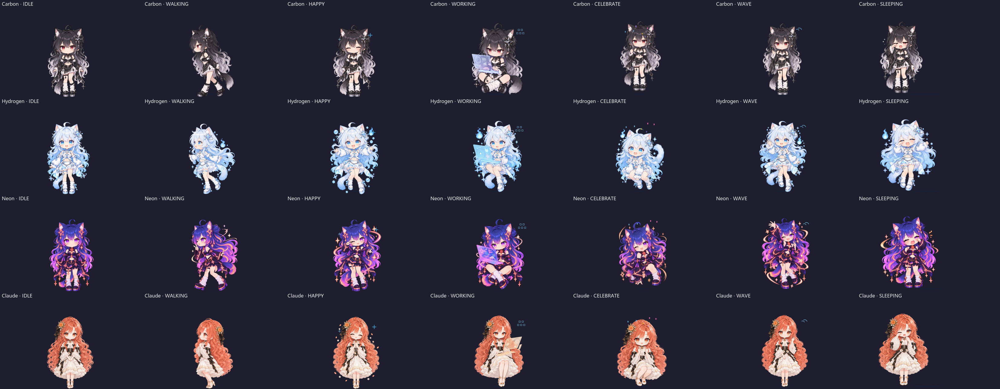

# AGY ペット · Antigravity Desktop Pet

**日本語** | [简体中文](README.md) | [English](README.en.md)

Antigravity でのコーディングに寄り添うデスクトップペット＆ネイティブ Antigravity プラグインです。[QCYTSN/ds-local-pet](https://github.com/QCYTSN/ds-local-pet)（MIT）の行動フレームワークをベースに、お散歩・部位別リアクション・投げ物理・ウィンドウ着地・ローカル環境認識・クラッシュ復旧を継承しつつ、**5つのモデル擬人化形態（Carbon / Hydrogen / Neon / Argon / Claude）**、**サブエージェント分身＆デスクトップシーン遊び**、内蔵 **Token Meter**、リアルタイム **HUD バー**、Antigravity サイドバー操作パネル（**`agy-pet`**）、そして **中国語・英語・日本語の3言語完全対応** を備えています。



### 主な特徴

- **5つのモデル擬人化形態**：Carbon、Hydrogen、Neon、Argon、Claude それぞれに専用スプライト、モーション個性、好物／苦手な食べ物、3言語対応の専用セリフを用意。「モデル追従」をオンにすると、Antigravity で使用中のモデルに合わせて自動で姿を切り替えます。
- **日・英・中 3言語フル対応＆リアルタイム切替**：初期設定は `auto`（OS／ブラウザ言語を自動判定）。サイドバー、右クリック設定パネル、タスクトレイのどこからでも再起動なしで即座に切り替え可能。UI・HUD・Token Meter・ツールチップ・トレイ・分身の掛け合い・AI 実況・5形態＋12種の共通セリフまで完全対応。
- **標準 Antigravity ネイティブプラグイン構造**：リポジトリルートがそのままプラグインパッケージ（`plugin.json`、`hooks.json`、`sidecars/pet-bridge/`、`skills/agy-pet/`）。サイドバーから状態確認・形態切替・言語切替・会話固定・ペット起動までワンクリック。
- **高精度コンテキスト＆二段クォータ HUD**：ローカル言語サーバー RPC、Hooks、`annotations/*.pbtxt`、ワークスペース切替を組み合わせて閲覧中のセッションを的確に追跡（新規空白チャットは自動で 0 表示）。単ステップの思考トークンを除外した実効コンテキスト、`tok/s`、5時間／週間の2枠クォータ、キャッシュヒット率を表示します。
- **サブエージェント分身＆デスクトップシーン**：サブエージェント稼働時や待機中の遊び相手としてミニ分身（同形態の双子・ミニ自分を含む）が登場し、なでなで・ウェーブ・ティーパーティー・焚き火・星空観察・クッション砦などを繰り広げます。
- **内蔵 Token Meter＆利用状況ダッシュボード**：全モデルランキング、ステップ別速度・TTFT、月間カレンダー／年間ヒートマップ、Gemini API 換算コストを IDE 外からも単体表示できます。
- **完全ローカル動作＆プライバシー保護**：読み取るのはローカルの Antigravity プロセスとセッションログのみ。外部送信なし、トークンや CSRF シークレットをディスクに保存しません。

## インストールと起動

### 方法1：Antigravity ネイティブプラグインとして導入（推奨）

リポジトリルートが標準プラグイン構成になっています：

```powershell
git clone https://github.com/Gengetau/antigravity-pet.git
cd antigravity-pet
py -3.13 -m pip install -r requirements.txt
agy plugin install .
```

インストール前の厳格チェックにも対応しています：

```powershell
agy plugin validate --strict .
```

導入後、Antigravity サイドバーの「AGY ペット」パネルから「ペットを起動」を押すか、リポジトリルートの `启动AGY桌宠.cmd` をダブルクリックすると起動（すでに起動中なら前面へ呼び出し）します。

### 方法2：単体デスクトップペットとして起動

```powershell
git clone https://github.com/Gengetau/antigravity-pet.git
cd antigravity-pet
py -3.13 -m pip install -r requirements.txt
```

`启动AGY桌宠.cmd` をダブルクリック（`pythonw` でコンソールなし起動）、またはターミナルから直接実行します：

```powershell
py -3.13 main.py
```

## 5つの形態

| 形態 | 素材ディレクトリ | 対応する Antigravity モデル |
| --- | --- | --- |
| Carbon | `carbon/` | Gemini 4 Carbon、Orchestrator (Carbon) |
| Hydrogen | `hydergon/` | Gemini 4 Hydrogen |
| Neon | `neon/` | Gemini 4 Neon、Orchestrator (Neon) |
| Argon | `argon/` | Gemini 4 Argon |
| Claude | `claude/` | Antigravity 内の Claude モデル／Claude Code・Claude Desktop からの MCP 通知時に一時登場 |

- **手動切替**：ペットを右クリックして設定パネルの「形態」行から選択、またはタスクトレイ →「形態を切替」。
- **モデル追従**：「モデル追従」を有効にすると、生成中は最新ステップの実モデル、待機中は選択中モデルに合わせて自動変身します。手動切替すると追従はオフになります。
- ドラッグ中・落下中の切替は着地を待ってから実行し、足元の位置をそのまま保ちます。

| 形態 | 性格 | モーションの特徴 | セリフ例 |
| --- | --- | --- | --- |
| Carbon | クール・無口・ちょいツンデレ | 控えめな動き、腕組み、嬉しい時は静かに微笑む | 「夜更かしすると構造が脆くなるだけ。」 |
| Hydrogen | 元気・天然・一人称「ヒドちゃん」 | 軽やかでつま先立ちや小浮遊、周りにしゃぼん玉 | 「ヒドちゃんは一番軽い元素なんだよ〜」 |
| Neon | 自信満々なアイドル気質 | ピース・ウインク・観客への指差しとネオン光 | 「こらっ、ファンは一列に並んで！」 |
| Argon | 半目マイペースな希ガス少女、猫クッション愛用 | 常にクッション抱え、窓登り時は背中に背負う | 「つついても反応しないよ……不活性だから。」 |
| Claude | 穏やかで段取り上手なお嬢様 | 優雅な所作、メモ帳や顎に手を当てて熟考 | 「エラーは拝見しました。まだ1か所、未確認の部分があります。」 |

形態別セリフは `assets/dialogue/forms/<形態>.json`（中国語）および `assets/dialogue/locales/{en,ja}/forms/<形態>.json`（英語／日本語）に収録されています。性格が「標準」の時は形態専用セリフ、それ以外（毒舌・やさしい・コミュニティ）では共通ローカライズセリフを使用します。

## 言語切替（日本語 / English / 中文）

- 初期設定は `agy.language = "auto"`（OS・ブラウザのロケールから自動判定：`ja*` → 日本語、`zh*` → 中国語、`en*` などその他 → 英語）。
- 再起動なしで即座に切替可能：
  - **Antigravity サイドバー** → **言語** セレクト（`Auto / 中文 / English / 日本語`）
  - **ペット設定パネル** → **詳細** → **言語** ボタン（`Auto / 中文 / EN / 日本語`）
  - **タスクトレイ** → **言語 / Language** サブメニュー
- 設定は `config.json` に保存され、サイドバーとデスクトップペット間で約 1.5 秒以内に双方向同期されます。起動時のみ一時指定したい場合は環境変数 `AGY_PET_LANG`（`ja` / `en` / `zh`）も利用できます。

## HUD フローティングバー

`⚡ tok/s | 枠 5h % / 週 % | キャッシュ % | 文脈 使用量 (%)` を常時表示。マウスオーバーでセッション平均速度、E2E、TTFT、枠リセットまでのカウントダウン、詳細トークン数、データソースを確認できます。

- **ペット追従**（初期設定）：足元に追従表示（画面下端に近い場合は頭上へ自動回避）。
- **独立フローティング**：右クリック →「独立表示」で好きな場所（入力欄のそば等）にドラッグ配置でき、座標ロックにも対応。
- **外観切替**：ダイアログ（初期設定：会話タイトル＆モデル付き）／ダークピル／枠なし／すりガラス。
- **警告しきい値**：クォータ ≤35% 黄色・≤15% 赤色／コンテキスト ≥55% 黄色・≥80% 赤色。

## Token Meter＆利用状況ダッシュボード

HUD バーのダブルクリック、設定パネルの「Token Meter」、またはタスクトレイから開けます。

- **上部4カード**：生成速度（最新ストリーミング／セッション平均／E2E／TTFT）、クォータ残量（5時間＆週間）とリセット時間、キャッシュヒット率、コンテキスト使用率。
- **利用状況ダッシュボード**：累計トークン、日別ピーク、最長連続作業、連続日数、5時間／週間クォータバー、月間カレンダー＆年間ヒートマップ（モデル別・指標別フィルタ対応）。
- **API 換算コスト**：Gemini API 公式単価に基づく USD 換算（今日／直近7日／今月／キャッシュ節約額／モデル別内訳）。単価表は `assets/pricing.json` で編集可能。
- **全モデルランキング＆現在セッション詳細**：モデル別のトークン内訳・キャッシュ率・速度・TTFT、サブエージェント合算切替、直近60ステップの記録。

## おやつ（給餌）

右クリックパネルの「おやつ」から各形態専用の 5 種メニュー（大好物1・普通3・苦手1）をあげられます：

| 形態 | 大好物 | 苦手 |
| --- | --- | --- |
| Carbon | ブラックコーヒー ☕ | ペロペロキャンディ 🍭 |
| Hydrogen | シュワシュワサイダー 🥤 | 苦いコーヒー ☕ |
| Neon | レインボーキャンディ 🍬 | 白がゆ 🥣 |
| Argon | ホットミルク 🥛 | エスプレッソ ☕ |
| Claude | 紅茶 🫖 | 激辛スナック 🌶️ |

- **大好物**：機嫌と親密度が大きくアップし、特別な喜びリアクション。
- **普通**：おいしく食べます。
- **苦手**：よけて食べず、少し機嫌が下がります（給餌回数には加算されません）。
- 20 秒以内に 3 回連続であげると「お腹いっぱい」反応になります。

## リアクション・自律行動・分身コンパニオン

- **推論リアクション**：生成中はタイピング／思考モーションに入り、完了時に累計トークンを報告。180 tok/s 以上の高速出力を褒めたり、残り枠低下やコンテキスト 80% 超過をクールダウン付きで知らせます。
- **自律行動**：Antigravity や周辺の一般ウィンドウを登ったり飛び乗ったりして縁に座り、25 分無操作でお昼寝、残り枠が少ないとあくび、リセット時に祝福、90 分連続作業でストレッチを促します。
- **サブエージェント分身＆遊び仲間**：サブエージェント稼働に合わせてミニ分身が登場し、待機中には同形態の双子やミニ自分と一緒にティーパーティー・焚き火・星空観察・クッション砦で遊びます。
- **AI 実況コメント（任意オン）**：サイドバーで有効にすると、最安ローカルモデルを使って現在の言語（日本語／英語／中国語）＆形態の口調で短い実況を生成します（予算上限＆インジェクション除去付き）。

## データソースとプライバシー

すべてのデータソースは **ローカル限定・読み取り専用** です：

1. **ローカル Antigravity 言語サーバー**：自身の `language_server` プロセスから起動時 CSRF トークンを取得し、`127.0.0.1` のみに RPC 接続。トークンはログやディスクへ一切書き出しません。
2. **`agy-pet` ブリッジ（`pet_live.json`）＆ `token-meter`（`hud_live.json`）**：Hooks（`SessionStart` / `PreInvocation`）、`annotations/*.pbtxt`、ワークスペース切替からアクティブ会話を高精度に追従。
3. **ローカル会話ログ**（`~/.gemini/antigravity/brain/.../transcript.jsonl`）：Antigravity 終了時のフォールバック（パネルに「オフライン」と表示）。

## 設定（`config.json`）

リポジトリルート `config.json` の `agy` セクションで調整できます：

| キー | 初期値 | 説明 |
| --- | --- | --- |
| `language` | `auto` | 表示＆セリフ言語：`auto` / `zh` / `en` / `ja` |
| `form` | `carbon` | 現在の形態 |
| `follow_model` | `false` | モデルに応じて形態を自動切替 |
| `telemetry_enabled` | `true` | ローカル Antigravity テレメトリの取得 |
| `use_language_server` | `true` | `false` にするとローカルファイルのみ参照 |
| `reactions` | `true` | トークン・速度・クォータ変化へのリアクション |
| `autonomy` | `true` | 窓登り・居眠り・ストレッチ等の自律行動 |
| `hop_to_window` | `true` | 生成中に Antigravity ウィンドウ上へ乗る |
| `explore_windows` | `true` | 待機中に周辺ウィンドウ間を移動して遊ぶ |
| `hud_enabled` / `hud_mode` / `hud_appearance` / `hud_locked` | `true` / `attached` / `dialog` / `false` | HUD バーの表示・モード・外観・座標ロック |
| `pinned_conversation` | `""` | 監視対象の会話 ID を固定（空で自動追従） |
| `ai_comments` | `false` | ローカル AI による口調付き実況コメント |

## プロジェクト構成

```text
plugin.json / hooks.json / hooks/ / sidecars/pet-bridge/ / skills/agy-pet/   標準 Antigravity プラグイン＆サイドバーブリッジ
agy/          形態定義、テレメトリ、リアクション、自律行動、HUD バー、Token Meter、利用状況ダッシュボード
carbon/ hydergon/ neon/ argon/ claude/   5形態のスプライト素材＆アクション定義
assets/       基本アクション、アイコン、3言語セリフパック（assets/dialogue/locales/{en,ja}/）、単価表、プライバシー設定
app/ animation/ awareness/ behavior/ dialogue/ pet/ settings/   ペット本体エンジン、i18n、分身、シーン小物
tests/        ユニットテスト・i18n 検証・AI コメントテスト・オフスクリーン Qt UI テスト
```

## テスト

```powershell
$env:QT_QPA_PLATFORM='offscreen'; py -3.13 -m pytest tests -q
node --test tests/test_ai_comment.mjs
```

## ライセンス

コードは MIT ライセンス（`LICENSE`・`CREDITS.md` 参照）で公開されています。5形態のキャラクター素材はすべて本プロジェクトのオリジナルです。
