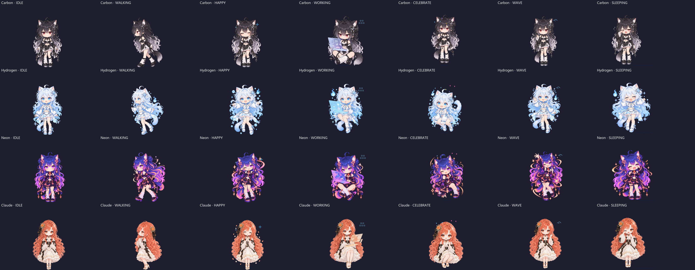

# AGY 桌宠 · Antigravity Desktop Pet

一个陪你用 Antigravity 写代码的桌面宠物与原生 Antigravity 插件。行为框架仿照 [QCYTSN/ds-local-pet](https://github.com/QCYTSN/ds-local-pet)（MIT），完整保留散步、分区互动、抛掷物理、窗口落脚、本地感知和崩溃恢复；在此基础上新增五种模型主题形态（**Carbon、Hydrogen、Neon、Argon、Claude**），并内置 **Token Meter 面板**、**HUD 实时悬浮条（agy-hud-bar）** 以及 Antigravity 侧边栏控制台插件（**`agy-pet`**）。



### 核心亮点

- **五形态模型拟人化陪伴**：Carbon、Hydrogen、Neon、Argon、Claude 五套独立运行时立绘与动作帧 + 专属形态台词，开启「跟随模型」后随 Antigravity 当前使用的模型自动换装。
- **标准 Antigravity 原生插件架构**：仓库根目录即插件包（含 `plugin.json`、`hooks.json`、`sidecars/pet-bridge/`、`skills/agy-pet/`），侧边栏直接查看状态、切形态、置顶会话与一键拉起桌宠。
- **精确上下文与双窗口限额 HUD**：结合语言服务 RPC、Hooks、`annotations/*.pbtxt` 与项目切换实时锁定当前焦点会话（空白新会话自动归零），剔除单步思考 token 虚高统计，头顶实时显示 `tok/s`、5h/每周双窗口限额与缓存命中率。
- **内置独立桌面 Token Meter 与费用看板**：支持全球模型榜单、逐步速率/TTFT、热力图用量日历与按 Gemini API 标价折算的等效费用统计，不开启 IDE 侧边栏也能独立查看。
- **懂事的自主行为与纯本机隐私**：支持陪着干活爬窗/坐窗沿、闲置小睡、低限额打哈欠与恢复庆祝；所有数据只读本机进程与日志文件，不主动联网、不写入 token 到磁盘。

## 安装与启动

### 方式一：作为 Antigravity 原生插件安装（推荐）

本仓库本身符合标准 Antigravity 插件结构（根目录含 `plugin.json`、`hooks.json`、`hooks/`、`sidecars/pet-bridge/`、`skills/agy-pet/`）：

```powershell
git clone https://github.com/Gengetau/antigravity-pet.git
cd antigravity-pet
py -3.13 -m pip install -r requirements.txt
agy plugin install .
```

安装前也可用严格校验命令自检：

```powershell
agy plugin validate --strict .
```

装好插件与 Python 依赖后，直接在 Antigravity 侧边栏「AGY 桌宠」面板中点击「启动桌宠」，或双击仓库根目录的 `启动AGY桌宠.cmd` 即可拉起或唤醒桌面宠物。

### 方式二：仅作为独立桌面宠物运行

```powershell
git clone https://github.com/Gengetau/antigravity-pet.git
cd antigravity-pet
py -3.13 -m pip install -r requirements.txt
```

装好后双击 `启动AGY桌宠.cmd`（`pythonw` 后台无黑框启动，重复启动会唤回已运行的桌宠），也可以在终端里直接运行：

```powershell
py -3.13 main.py
```

## 五种形态

| 形态 | 素材目录 | 对应的 Antigravity 模型 |
| --- | --- | --- |
| Carbon | `carbon/` | Gemini 4 Carbon、Orchestrator (Carbon) |
| Hydrogen | `hydergon/` | Gemini 4 Hydrogen |
| Neon | `neon/` | Gemini 4 Neon、Orchestrator (Neon) |
| Argon | `argon/` | Gemini 4 Argon |
| Claude | `claude/` | Antigravity 里的 Claude 模型；Claude Code / Claude 桌面端通过 MCP 汇报时临时登场 |

- **手动切换**：右键桌宠打开控制面板，点「形态」一行；或者托盘 → 切换形态。
- **跟随模型**：勾选「跟随模型」后，桌宠会根据 Antigravity 当前使用的模型自动换形态。模型正在生成时，以最近一步实际用的模型为准；空闲时以选择器里选中的模型为准。GPT 等没有对应形态的模型不会触发切换。手动选择形态会自动关闭跟随。
- 桌宠在拖拽或下落途中时，切换会等她落地后再执行。切换时脚底位置保持不变。

Carbon、Hydrogen、Neon 沿用原来的猫娘外形，Argon 是新画的淡紫银发猫娘（抱猫猫枕、穿猫猫拖鞋），Claude 是人类少女；各自的动作风格和台词都不同：

| 形态 | 性格 | 动作风格 | 台词示例 |
| --- | --- | --- | --- |
| Carbon | 冷静、话少、有点傲娇 | 克制、幅度小，常抱臂，开心时只是轻轻一笑 | 「熬夜只会让结构变脆。」 |
| Hydrogen | 元气、天然呆，自称小氢 | 轻快，常踮脚或微微浮空，身边带泡泡 | 「小氢是最轻的元素哦～」 |
| Neon | 自信张扬的偶像 | 比 V、眨眼、指向观众，带霓虹光效 | 「喂，粉丝要排队！」 |
| Argon | 慢悠悠、总是半睁眼的惰性气体，抱着猫猫枕 | 大部分动作都抱着枕头；爬窗时枕头绑在背上，庆祝是把枕头举过头顶 | 「戳我也不会反应的……惰性的。」 |
| Claude | 温和认真、有条理，带点大小姐气质 | 端庄，常拿小本子、托腮思考，庆祝也很优雅 | 「报错我看过了，还有一处没验证。」 |

台词在 `assets/dialogue/forms/<形态>.json`，覆盖了日常、互动、状态以及对 Antigravity 的反应等全部场景。控制面板里的个性选「标准」时使用形态台词；选其他个性（毒舌、温和、社区梗）时沿用共用台词。动作帧由 `tools/sprite_gen/` 用原来的正面立绘作参考图生成，流程见 [docs/ACTION_DESIGN.md](docs/ACTION_DESIGN.md)。

## HUD 悬浮条（agy-hud-bar）

`⚡ tok/s | 限额 5h % / 周 % | 缓存 % | 上下文 已用 (占比)`，限额分上下两排：上面是 5 小时窗口，下面是每周额度。鼠标悬停能看到详细信息（会话均值、端到端速率、TTFT、限额重置倒计时、精确上下文 token 数、数据来源）。

- 默认**跟随桌宠**：显示在她的脚下；如果脚下贴着屏幕底边，就显示在头顶。
- 右键 → **独立悬浮**：可以拖到 Antigravity 输入框旁边，位置会记住，并且可以锁定坐标。
- 右键菜单还能切换外观（对话框 / 暗色胶囊 / 无边框融合 / 毛玻璃；对话框是默认：浅色圆角卡片，第一行是会话标题，第二行是当前模型，下面四项数据，小尖角指向桌宠）、自动跟随最新对话或指定监控某个会话，以及打开 Token Meter。
- 颜色阈值沿用原版：限额 ≤35% 显示黄色、≤15% 显示红色；上下文 ≥55% 显示黄色、≥80% 显示红色。

## Token Meter 面板（token-meter）

双击 HUD 条、点控制面板里的「Token Meter 面板」，或者从托盘都能打开。

- **顶部四张卡片**：生成速率（最新流式 / 会话均值 / 端到端 / TTFT）、限额剩余（5h 和每周）和重置倒计时、缓存命中、上下文占用。
- **用量看板**：累计 Token、单日峰值、最长连续工作、最长 / 当前连续天数；5 小时窗口和每周额度两条进度；每日活动热力图，默认按月显示成日历，可以切到按年（可按模型、指标筛选，切换每天 / 每周 / 累计总量）。只统计 Token Meter 读得到的会话。
- **等效 API 费用**：按 Gemini API 官方标价把用量折算成美元：今天、近 7 天、本月、缓存省下多少，以及按模型的明细；热力图也可以改看每天的金额。每一步按当天生效的价格计（Carbon / Argon 2026-12-01 起涨价）。价格表在 `assets/pricing.json`，可以自己改。

**限额的两档**：token-meter 侧边栏插件会调用语言服务的 `GetUserQuotaSummary`，把各额度桶（带 `window`）写进 `hud_live.json` 的 `quotaBuckets`；按窗口归成 5 小时和每周两类，同类取剩余最少的那个。语言服务没有这个接口或没返回桶时，退回到原来的单一限额：重置时间在 5 小时内就算 5h 窗口，否则算每周。
- **全局模型榜单**：每个模型的总 Token、占比、输入、缓存读、思考、正文、缓存命中率、流式 tok/s（均值和峰值）、端到端 tok/s、平均 TTFT、步数。可以选择是否合并子代理。
- **当前会话计速**：最近 60 步，每一步的模型、token 拆分、TTFT、速率和工具调用。

指标口径和 token-meter 插件一致：总 Token = 输入 + 缓存读 + 输出（含思考）；流式 tok/s = 输出 ÷ (完成时间 − 首包时间)；端到端 = 输出 ÷ (完成时间 − 请求时间)。

## 桌宠对 Antigravity 的反应

- 开始生成时进入思考动作；生成结束后开心地报出本轮累计 token。
- 流式速率 ≥180 tok/s 时会夸一句速度快。
- 限额 ≤25% 时提醒一次；≤10% 时会生气，并告诉你多久后重置。
- 上下文 ≥80% 时会晕一下，提醒你开个新会话（每个会话只提醒一次）。
- 所有反应都有冷却时间，不会刷屏。

## 自主行为

在控制面板里打开「自主行为」开关（默认开启）后，桌宠会根据 Antigravity 的状态自己安排动作：

- **陪着干活**：生成时进入打字动作；如果 Antigravity 窗口在最前面、而且没有最大化，每轮生成最多上一次窗口顶边（两次至少间隔 10 分钟）：窗口贴着地面、离她不远时，她会走到窗口侧边爬上去再翻上顶边，否则直接跳上去；之后跟着窗口移动。生成结束后坐在窗沿上、两腿垂在窗口外，6 分钟后恢复平常的活动。
- **爬窗口 / 坐窗沿**：设置面板「高级」里的「爬窗口」会让她爬上最近一次在前台的窗口；「坐窗沿」在她已经站在窗口上时直接坐下，否则先爬（爬不了就跳）上去再坐。爬的途中窗口移动、关闭或最小化，或者被你抓住，她会掉下来。
- **小睡**：25 分钟没有新 token，并且你 5 分钟没碰键鼠，就会去睡觉；新一轮生成开始时醒来挥手。
- **疲惫和恢复**：限额 ≤25% 时隔几分钟打个哈欠；限额恢复到 ≥90% 时会庆祝。
- **伸懒腰**：连续工作超过 90 分钟（中间停顿不超过 10 分钟）提醒你伸个懒腰。
- **打招呼**：Antigravity 关闭超过 1 分钟后重新打开时，会挥手打招呼。

自主行为不会打断你正在进行的互动（拖拽、喂食、摸头、面板打开期间都会让开）。新动作目前借用已有素材加程序特效，美术规格见 [docs/ACTION_DESIGN.md](docs/ACTION_DESIGN.md)。

## 数据来源与隐私

数据来源按优先级依次尝试，**全部只读，只访问本机**：

1. **本地 Antigravity 语言服务**：从你自己的 `language_server` 进程参数里读取这次启动的 CSRF token，并探测它在 127.0.0.1 上的端口，然后调用 `GetUserStatus`、`GetAllCascadeTrajectories`、`GetCascadeTrajectory`。token 不会写进日志，也不会保存到磁盘。
2. **`agy-pet` 插件桥接（`pet_live.json`）与 `token-meter`（`hud_live.json`）**：本仓库已按标准 Antigravity 插件格式组织（根目录 `plugin.json`、`hooks.json`、`sidecars/pet-bridge/`），安装并启用后，通过 `SessionStart` / `PreInvocation` 钩子、窗口浏览时间（`annotations/*.pbtxt`）与项目配置切换实时锁定当前正在看的会话（空白新会话自动归零），并输出剔除单步思考 token 后的精确上下文占用与 5h / 每周额度桶。
3. **本地会话日志** `~/.gemini/antigravity/brain/*/…/transcript.jsonl`：Antigravity 没开时用。这种情况下拿不到限额，速率是按日志间隔估算的，面板上会标明「离线」。

原作的 GitHub 自动更新已经移除，桌宠不会主动联网。原有的环境感知隐私规则保持不变。

## 配置

源码运行时，配置写在项目根目录的 `config.json`，其中 `agy` 段可以调整：

| 键 | 默认 | 说明 |
| --- | --- | --- |
| `form` | `carbon` | 当前形态 |
| `follow_model` | `false` | 是否跟随模型自动切换形态 |
| `telemetry_enabled` | `true` | 是否读取 Antigravity 遥测数据 |
| `use_language_server` | `true` | 设为 `false` 时只读本地文件 |
| `reactions` | `true` | 桌宠是否对 token 变化做出反应 |
| `autonomy` | `true` | 是否启用自主行为 |
| `hop_to_window` | `true` | 是否允许跳上 Antigravity 窗口 |
| `explore_windows` | `true` | 空闲时偶尔自己爬上附近的窗口，待几分钟再跳下来 |
| `hud_enabled` / `hud_mode` / `hud_appearance` / `hud_locked` | `true` / `attached` / `dialog` / `false` | HUD 悬浮条设置 |
| `pinned_conversation` | `""` | 指定监控的会话，留空表示自动跟随 |

## 项目结构

```text
plugin.json / hooks.json / hooks/ / sidecars/pet-bridge/ / skills/agy-pet/   标准 Antigravity 插件入口与桥接侧边栏
agy/          形态定义、遥测采集、桌宠反应、自主行为、HUD 悬浮条、Token Meter 窗口与用量看板
carbon/ hydergon/ neon/ argon/ claude/   五种形态的素材（每个目录的 manifests/actions.json 只描述帧）
assets/       基础动作定义 actions_base.json、图标 logo.png、台词、应用分类、隐私规则
app/ animation/ awareness/ behavior/ dialogue/ pet/ settings/   沿用原作的桌宠框架
tests/        单元测试和离屏界面测试
token-meter/  Antigravity 侧边栏插件源码副本（已同步精确上下文与会话焦点排序）
agy-hud-bar/  原 PowerShell 悬浮条（未改动，可以单独使用）
```

## 测试

```powershell
$env:QT_QPA_PLATFORM='offscreen'; py -3.13 -m pytest -q
```

## 许可

代码部分沿用原作的 MIT 许可（见 `LICENSE`、`CREDITS.md`）。原作的大肥鱼美术素材没有复制到本项目，五种形态均为本项目自制素材。
